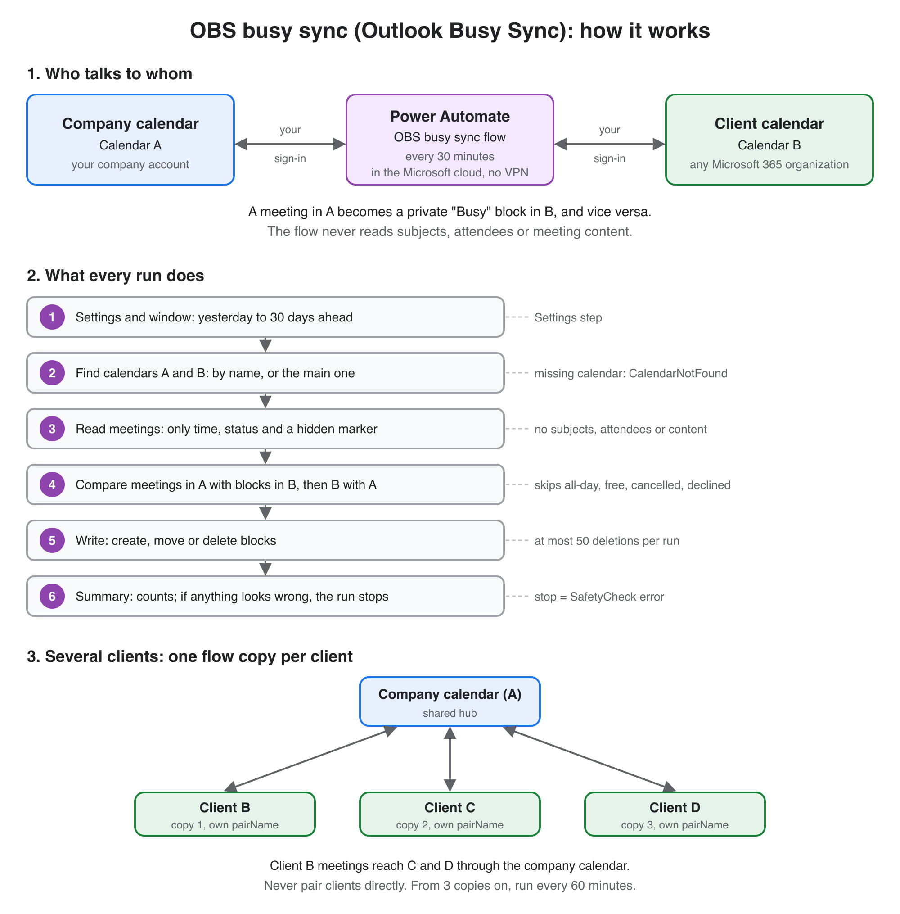

# OBS busy sync (Outlook Busy Sync): your busy time visible in both companies

Every 30 minutes this Power Automate flow copies your meetings between your company calendar and your client calendar as private "Busy" blocks. Nobody sees subjects or attendees: the flow never reads them.

## Before you start (2 min)
- [ ] Your client uses Microsoft 365 for mail (you sign in at outlook.office.com).
- [ ] Your client's IT is fine with it. Ask if you are not sure.
- [ ] You have `obs-busy-sync.zip` and 15 minutes.

## Step 1. Upload the package
1. Open make.powerautomate.com and go to **My flows**.
2. Select **Import** > **Import Package (Legacy)**.
3. Select **Upload** and pick `obs-busy-sync.zip`.
4. Wait about a minute until the package details appear.

## Step 2. Connect your accounts
1. In the **Calendar A** row, click the **IMPORT SETUP** field.
2. Select **Create new** and sign in with your **company account**.
3. Go back to the import tab, refresh the list, select the new connection and **Save**.
4. Do the same for **Calendar B**, with your **client account**.
5. Select **Import**. "OBS busy sync" now appears in **My flows**, turned off.

## Step 3. Dry run
1. Open the flow, select **Edit**, then the **Settings** step.
2. Change `"dryRun": false` to `"dryRun": true` and save.
3. Go back and **turn on** the flow. The first run starts right away and writes nothing.
4. After 1-2 minutes open the run history, the latest run, then the **Summary** step.
5. Check two things:
   - `viewA` = `countA` and `viewB` = `countB`;
   - `AtoB.create` (blocks for the client calendar) and `BtoA.create` (blocks for the company calendar) roughly match your number of meetings in the next 30 days.

## Step 4. Go live
1. Select **Edit** > **Settings**, set `"dryRun": false` and save.
2. Within 30 minutes you will see "Busy" blocks in both calendars.

**It works when** the next run shows `create`, `update` and `delete` at 0 in both directions in Summary.

## Second client?
- Import the same zip again, choose **Create as New** and give it another name.
- Calendar A is the same company account, Calendar B is the new client.
- Before you turn it on, set `"pairName"` in Settings, e.g. `"acme"`. Letters and digits only, different for each copy.
- From 3 copies on, change the **Recurrence** trigger from 30 to 60 minutes to stay under the daily request limit.

## Don't
- **Don't turn off concurrency control,** even if Power Automate suggests it. Parallel runs create duplicate blocks.
- **Don't pair two clients directly.** Busy time already reaches them through the company calendar.
- **Don't update a flow that is on.** Turn it off, import with **Update**, re-enter your Settings, then turn it on.

## Troubleshooting
| Error | What to do |
|---|---|
| CalendarNotFound | Fix the name in `calendarA` / `calendarB`, or leave it empty |
| TooManyEvents | Lower `daysAhead` in Settings |
| SafetyCheck | In Summary, check that `viewA` = `countA` and `viewB` = `countB`. If it keeps failing, turn the flow off and report it |
| Can't create the Calendar B connection | Your client's organization blocks Power Automate. Nothing to fix on your side |

## Turning it off
Turn the flow off. Existing blocks stay in the calendars: delete them by hand or let them pass.

Every setting explained: [GUIDE.md](GUIDE.md)
